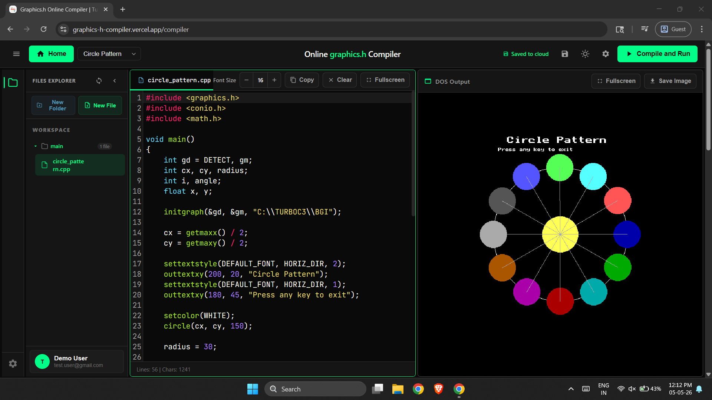
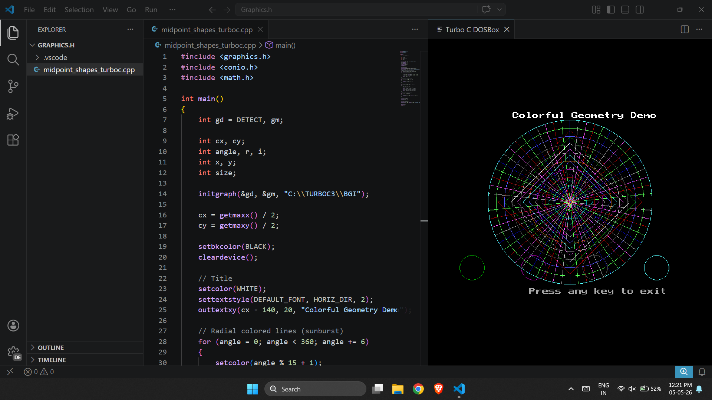

<div align="center">


<h1>Your graphics.h programs. Ready to run.</h1>

<p>Write C++ and see the graphics, in your browser or inside VS Code.<br />Original Turbo C++ behavior, without the manual DOSBox setup.</p>

<p><a href="https://graphicsh.online/compiler"></a>&nbsp;&nbsp;<a href="https://marketplace.visualstudio.com/items?itemName=AlbatrossC.graphics-h-compiler"></a></p>

<p><sub>No account needed to run code &nbsp;&middot;&nbsp; Optional Google cloud sync &nbsp;&middot;&nbsp; Offline build available</sub></p>

<p><a href="#online-compiler">Browser</a> &nbsp;/&nbsp; <a href="#vs-code-extension">VS Code</a> &nbsp;/&nbsp; <a href="#try-it">Example</a> &nbsp;/&nbsp; <a href="#run-locally">Local setup</a> &nbsp;/&nbsp; <a href="#developer-docs">Developer docs</a></p>

</div>

---

## A familiar library, a simpler start

`graphics.h` is Borland's classic graphics library, familiar to many students through Turbo C++. This project runs the original `TCC.EXE` inside DOSBox compiled to WebAssembly, so compilation and execution happen locally in your browser.

| Start in the browser | Stay in your editor |
|:---|:---|
| Open the compiler and run your first program. | Install the extension and use `Ctrl + Alt + N`. |
| No installation or account required. | Choose Turbo C++ or native WinBGI output. |
| [Open online compiler](https://graphicsh.online/compiler) | [Install from Marketplace](https://marketplace.visualstudio.com/items?itemName=AlbatrossC.graphics-h-compiler) |

## Online compiler

A code editor and graphics output, together in one workspace. Write a program, click **Run**, and see the result.

<p align="center"><br /><sub>CodeMirror 6 with syntax highlighting, autocomplete, parameter hints, and function documentation.</sub></p>

### Pick up where you left off

Sign in with Google to save files into folders and access them from another device. Signing in is optional for compiling and running code.

<p align="center"><br /><sub>Your programs, organised in a cloud workspace.</sub></p>

<details>
<summary><strong>Explore browser features</strong></summary>

<table>
<thead>
<tr><th>Feature</th><th>What you get</th></tr>
</thead>
<tbody>
<tr><td>Original compiler</td><td>Turbo C++ 3.0 running inside DOSBox WASM</td></tr>
<tr><td>Graphics reference</td><td>Editor documentation for all 99 supported graphics.h functions</td></tr>
<tr><td>Cloud workspace</td><td>Google sign-in, folders, and file sync across devices</td></tr>
<tr><td>Offline support</td><td>Compile and run after the required assets have been cached</td></tr>
<tr><td>Portable build</td><td>A self-contained HTML compiler for offline use</td></tr>
</tbody>
</table>

</details>

> [!TIP]
> **Taking it offline?** Download the [standalone HTML compiler](../site/compiler-assets/unified/graphic.h-compiler-unified.html). Keep one file and run it without a server. [How the standalone build works](../site/compiler-assets/unified/graphic.h-compiler-unified.md).

## VS Code extension

Compile and run without leaving your editor. Install from the [VS Code Marketplace](https://marketplace.visualstudio.com/items?itemName=AlbatrossC.graphics-h-compiler), or use:

```bash
code --install-extension AlbatrossC.graphics-h-compiler
```

Open your C++ file and press **Ctrl + Alt + N**. Run and stop controls are also available in the status bar.

### Turbo C++ / integrated output

Run the original compiler and view DOS graphics inside a VS Code webview. Available on Windows, macOS, and Linux.

<p align="center"><br /><sub>Classic Turbo C++ behavior, alongside your source code.</sub></p>

### WinBGI / native output

Compile with MinGW-w64 (GCC 11.5.0) and open a native graphics window. The extension installs the toolchain on first use; Linux also requires Wine.

<p align="center"><br /><sub>Native Windows graphics, with GCC diagnostics in the editor and Problems panel.</sub></p>

| | Turbo C++ | WinBGI |
|:---|:---|:---|
| **Best for** | Original Turbo C++ programs | WinBGI-compatible programs |
| **Compiler** | Turbo C++ 3.0 | GCC 11.5.0 / MinGW-w64 |
| **Output** | Integrated DOSBox webview | Native Win32 window |
| **Platforms** | Windows, macOS, Linux | Windows; Linux via Wine |
| **Setup** | No separate DOSBox installation | Automatic toolchain installation; Wine on Linux |

## Try it

Paste this into the [online compiler](https://graphicsh.online/compiler), or save it as a C++ file in VS Code.

```cpp
#include <graphics.h>
#include <conio.h>

int main() {
    int gd = DETECT, gm;
    initgraph(&gd, &gm, "");

    setcolor(YELLOW);
    circle(320, 240, 100);              // Yellow circle

    setcolor(LIGHTCYAN);
    rectangle(200, 120, 440, 360);      // Cyan rectangle

    setcolor(LIGHTGREEN);
    line(100, 50, 540, 430);            // Green diagonal

    setcolor(WHITE);
    outtextxy(250, 420, "It works!");

    getch();
    closegraph();
    return 0;
}
```

## Run locally

You will need **Git**, **Node.js 18+**, and **Python 3**.

```bash
# Clone the project
git clone https://github.com/AlbatrossC/graphics-h-compiler.git
cd graphics-h-compiler

# Install JavaScript and Python dependencies
npm install
python -m pip install -r requirements.txt

# Build the static site into dist/
npm run build

# Serve the result
npx serve dist
```

Open **http://localhost:3000/compiler**. Cloud authentication and file sync require the API services; see the developer docs for configuration.

<details>
<summary><strong>Under the hood</strong></summary>

<table>
<thead>
<tr><th>Layer</th><th>Technology</th></tr>
</thead>
<tbody>
<tr><td>Compiler engine</td><td>Turbo C++ 3.0 via js-dos / DOSBox WASM</td></tr>
<tr><td>Code editor</td><td>CodeMirror 6 with C++ language support</td></tr>
<tr><td>Assets and build</td><td>esbuild, Python, and Jinja2</td></tr>
<tr><td>VS Code extension</td><td>TypeScript, Webview API, MinGW-w64</td></tr>
<tr><td>Hosting</td><td>Cloudflare Pages for the site; Workers for APIs</td></tr>
</tbody>
</table>

</details>

## Developer docs

| Guide | Contents |
|:---|:---|
| [Online compiler](online-compiler/readme.md) | WASM integration, editor configuration, and deployment |
| [VS Code extension](vscode-extension/vscode-compiler.md) | Architecture, compiler modes, and packaging |
| [Standalone build](../site/compiler-assets/unified/graphic.h-compiler-unified.md) | How the self-contained HTML compiler works |

Found a bug or have an idea? [Open an issue](https://github.com/AlbatrossC/graphics-h-compiler/issues) or send a pull request.

---

<p align="center">Built by <a href="https://github.com/AlbatrossC"><strong>AlbatrossC</strong></a> for everyone who just wants their graphics.h code to run.<br /><sub>If it helped, consider giving the project a star on GitHub.</sub></p>
