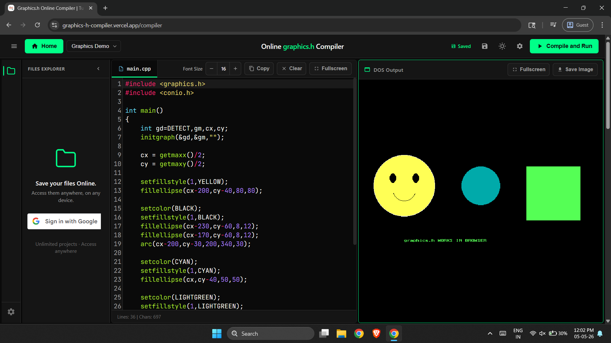
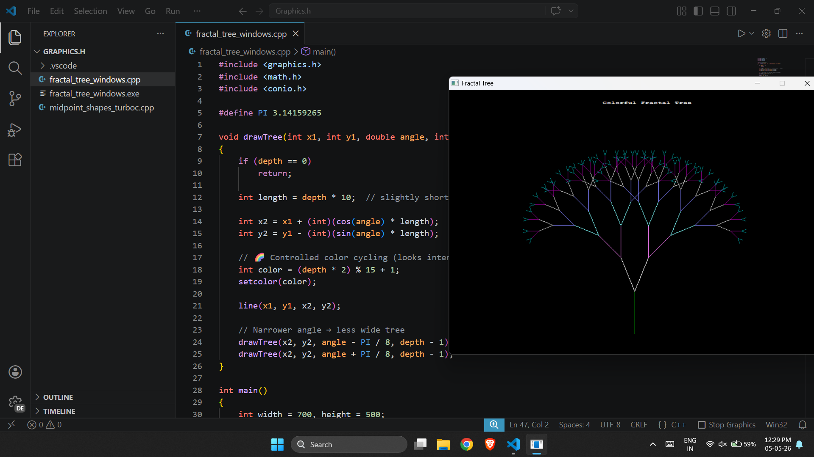

<div align="center">

<br>


<br>

<p><strong>Write, compile, and run Turbo C++ <code>graphics.h</code> programs — in your browser or VS Code</strong></p>
<p><sub>No manual DOSBox setup &nbsp;&middot;&nbsp; Browser or VS Code &nbsp;&middot;&nbsp; Offline options</sub></p>

<br>

<a href="https://marketplace.visualstudio.com/items?itemName=AlbatrossC.graphics-h-compiler">
  
</a>
&nbsp;&nbsp;
<a href="https://graphicsh.online/compiler">
  
</a>

<br><br>

</div>

---

## 📖 What is this?

**`graphics.h`** is Borland's DOS-era graphics library, familiar to many students through Turbo C++. Running those programs on a modern computer often requires extra setup.

The problem is getting it to run on a modern machine. The typical path: hunt down an old installer, configure DOSBox, debug why nothing renders. You spend more time fighting the environment than writing code.

**This project fixes that.** It runs the real `TCC.EXE` (Turbo C++ 3.0) inside DOSBox compiled to WebAssembly — with compilation and execution handled locally in your browser. Write code, hit Run, see graphics. Zero setup.

---

## 🌐 Online Compiler

> **→ [graphicsh.online/compiler](https://graphicsh.online/compiler)**
>
> Smart editor, instant compilation, live graphics output — all in the browser. No account required.

<br>

<div align="center">

<p><strong>✍️ Write Code → Click Run → See Output</strong></p>

<p></p>

<p><sub>CodeMirror 6 editor with C++ syntax highlighting, autocomplete, and inline docs for all 99 <code>graphics.h</code> functions.</sub></p>

<br>

<p><strong>☁️ Save Your Work to the Cloud</strong></p>

<p></p>

<p><sub>Sign in with Google to organise programs into folders, synced across all your devices.</sub></p>

</div>

<br>

<details>
<summary>&nbsp;<b>📋 Full feature list</b></summary>

<br>

| Feature | Details |
|:---|:---|
| 🔧 **Genuine Turbo C++ 3.0** | Runs the real `TCC.EXE` inside DOSBox WASM — pixel-perfect, authentic output |
| 📚 **Full API coverage** | All 99 functions: `initgraph`, `circle`, `arc`, `bar3d`, `floodfill`, fonts, and more |
| ✏️ **Smart editor** | Autocomplete, parameter hints, syntax highlighting, and hover docs for every function |
| ☁️ **Cloud sync** | Save programs to the cloud with Google Sign-In — synced across devices |
| 📶 **Offline support** | Cached after first load. Compile and run with no internet connection. |
| 📦 **Standalone build** | [Single HTML file](../site/compiler-assets/unified/graphic.h-compiler-unified.html) (~8 MB) — no server, no internet needed |

</details>

<br>

> [!TIP]
> **Need something portable?** The [standalone unified build](../site/compiler-assets/unified/graphic.h-compiler-unified.html) is a single self-contained HTML file — download it once, run it anywhere, forever offline.
> [Read the technical breakdown →](../site/compiler-assets/unified/graphic.h-compiler-unified.md)

---

##  VS Code Extension

> Two compilation backends. One keyboard shortcut. Compile and run `graphics.h` programs without leaving your editor.

<br>

<div align="center">

<p><strong>⚙️ Mode 1 · Turbo C++ (DOSBox Webview)</strong></p>

<p></p>

<p><sub>Compiles using real Turbo C++ 3.0 in an integrated webview panel. Pixel-perfect DOS graphics — works on Windows, macOS, and Linux.</sub></p>

<br>

<p><strong>⚡ Mode 2 · WinBGI (Native Windows)</strong></p>

<p></p>

<p><sub>Compiles via MinGW-w64 (GCC 11.5.0) to a native executable with a real Win32 graphics window. Toolchain auto-installs on first use.</sub></p>

</div>

<br>

### ⚖️ Choosing a Mode

| | ⚙️ Turbo C++ Mode | ⚡ WinBGI Mode |
|:---|:---:|:---:|
| **Platform** | Windows · macOS · Linux | Windows; Linux via Wine |
| **Output** | Integrated webview | Native Win32 window |
| **Compiler** | TCC.EXE (Turbo C++ 3.0) | GCC 11.5.0 via MinGW |
| **Compatibility** | Original Turbo C++ behavior | WinBGI-compatible programs |
| **Setup** | No separate DOSBox installation | Auto-installs toolchain; Wine required on Linux |
| **Best for** | Cross-platform · exact TCC output | Windows · native rendering |

<br>

<details>
<summary>&nbsp;<b>📋 Full feature list</b></summary>

<br>

| Feature | Details |
|:---|:---|
| 🔀 **Dual compilation** | Switch between Turbo C++ DOSBox and native WinBGI on the fly |
| 🔄 **Auto setup** | `MinGW-w64` downloads and configures itself automatically on first use |
| ⌨️ **Keyboard shortcut** | `Ctrl + Alt + N` to compile and run instantly |
| 🔴 **Error diagnostics** | GCC errors highlighted inline in your editor and in the Problems panel |
| 🖥️ **Cross-platform** | Windows (native + DOSBox), macOS (DOSBox), Linux (via Wine) |
| 📊 **Status bar controls** | Run and stop right from the VS Code status bar |

</details>

<br>

### 📥 Install

Get it from the **[VS Code Marketplace →](https://marketplace.visualstudio.com/items?itemName=AlbatrossC.graphics-h-compiler)**, or:

```bash
# via terminal
code --install-extension AlbatrossC.graphics-h-compiler

# or: Ctrl+Shift+X  →  search "graphics.h compiler"  →  Install
```

---

## 💻 Quick Example

Paste this into the [online compiler](https://graphicsh.online/compiler) and hit **Run**:

```cpp
#include <graphics.h>
#include <conio.h>

int main() {
    int gd = DETECT, gm;
    initgraph(&gd, &gm, "");

    setcolor(YELLOW);
    circle(320, 240, 100);              // Yellow circle

    setcolor(LIGHTCYAN);
    rectangle(200, 120, 440, 360);      // Cyan rectangle

    setcolor(LIGHTGREEN);
    line(100, 50, 540, 430);            // Green diagonal

    setcolor(WHITE);
    outtextxy(250, 420, "It works!");

    getch();
    closegraph();
    return 0;
}
```

> The original `TCC.EXE` runs inside DOSBox compiled to WebAssembly, rendering graphics in your browser.

---

## 🖥️ Running Locally

**Prerequisites:** [Git](https://git-scm.com/) &nbsp;·&nbsp; [Node.js v18+](https://nodejs.org/) &nbsp;·&nbsp; [Python 3](https://www.python.org/)

```bash
# 1. Clone
git clone https://github.com/AlbatrossC/graphics-h-compiler.git
cd graphics-h-compiler

# 2. Install dependencies & build
npm install
python -m pip install -r requirements.txt
npm run build
# Calls build-tools/build.py → bundles everything into dist/

# 3. Serve
cd dist && npx serve .
# → http://localhost:3000/compiler
```

---

## 🧰 Tech Stack

| Layer | Technology |
|:---|:---|
| **Compiler engine** | Turbo C++ 3.0 (`TCC.EXE`) via [js-dos](https://js-dos.com/) (DOSBox WASM) |
| **Code editor** | [CodeMirror 6](https://codemirror.net/) with C++ language support |
| **Bundler** | [esbuild](https://esbuild.github.io/) |
| **Build** | Python build script + npm |
| **VS Code extension** | TypeScript, Webview API, MinGW-w64 (GCC 11.5.0) |
| **Hosting** | Cloudflare Pages for the site; Cloudflare Workers for APIs |

---

## 🛠️ Developer Docs

| Section | Link | Covers |
|:---|:---|:---|
| **Online Compiler** | [Docs →](online-compiler/readme.md) | JS-DOS WASM integration, CodeMirror config, deployment |
| **VS Code Extension** | [Docs →](vscode-extension/vscode-compiler.md) | Extension architecture, Turbo C / WinBGI modes, packaging |

Contributions welcome — [open an issue](https://github.com/AlbatrossC/graphics-h-compiler/issues) or send a PR.

---

<div align="center">

<br>

Made with frustration and love by **[AlbatrossC](https://github.com/AlbatrossC)**

*If this saved you from a DOSBox config spiral, a ⭐ on GitHub means a lot.*

<br>

</div>